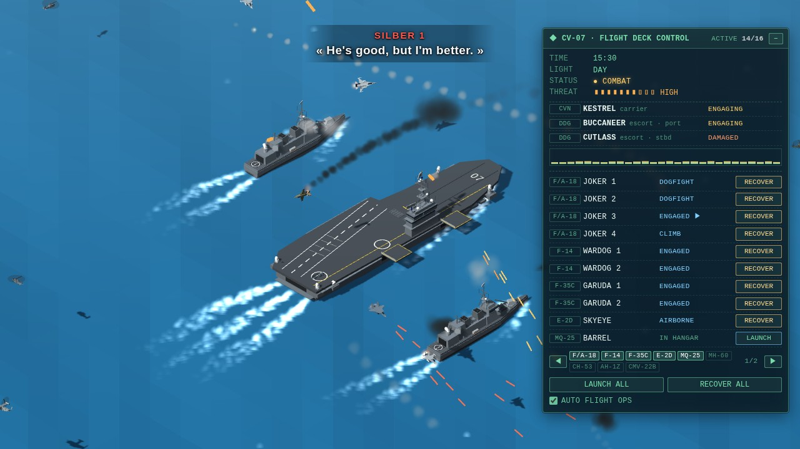

# Forward Air Base — web wallpaper for Wallpaper Engine

[](https://github.com/wladbelsky/air-base-wallpaper/actions/workflows/tests.yml)

Isometric forward air base: a runway, hardened aircraft shelters, hangars, a control tower, air defence and tanks on
the perimeter, and a configurable air wing that taxis, takes off and lands. Everything reacts to the music playing on
your PC: air defence, tanks and aircraft fire to the beat, Ace Combat style radio subtitles run at the top of the
screen, the time of day follows your PC clock and the ground follows the seasons.
The sequel to [Carrier Strike Group](https://github.com/wladbelsky/carrier-wallpaper).



- **Live demo** (runs in the browser): https://wladbelsky.github.io/air-base-wallpaper/

## Install

From source:

1. Copy the `Forward Air Base` folder into
   `...\Steam\steamapps\common\wallpaper_engine\projects\myprojects\`,
   or in Wallpaper Engine choose **Open Wallpaper → Open from File** and pick `project.json`.
2. Audio reaction needs audio recording enabled in the WE settings (it is on by default).
3. Panel buttons need mouse input enabled in WE. The mouse never moves the camera.
   WE doesn't pass the mouse wheel to wallpapers, so the aircraft list isn't scrolled: when it doesn't fit, it is
   split into pages (◀ 1/3 ▶) with a chip per aircraft type that jumps to it.

## The base

- One runway (09/27) with a parallel taxiway, an apron, hardened aircraft shelters with sliding blast doors, a big and
  a medium hangar for the heavies, two small hangars for the drones, a heliport with twelve pads, a control tower with
  a beacon, an airport surveillance radar, ops and squadron buildings, a fuel farm, a fire station, barracks, service
  roads and a fenced perimeter with a perimeter road, guard towers and a gate.
- Air defence on the edges: a Patriot battery (radar and four launchers), NASAMS, Avenger (Stinger) vehicles, C-RAM
  (Phalanx on trailers) and twin 35 mm AA guns; M1 Abrams tanks in revetments along the southern perimeter.
- At night: runway edge and threshold lights, the approach lights with their sequenced flashers, PAPI, blue taxiway
  lights, lit windows, floodlight masts over the apron, guard-tower searchlights sweeping the ground outside the fence
  and big sky searchlights sweeping the sky (in a fight they follow the enemy aircraft).
- **Seasons** (property **Season**: by the PC date, or fixed): winter — snow, snowy firs and roofs, snowfall;
  spring — green grass and trees; summer — desert, saguaro cacti, rocks and dry shrubs; autumn — golden and red trees,
  falling leaves. **Snowfall / falling leaves** can be switched off.
- **Base name** property: the tower's radio callsign and the panel title (default SAND ISLAND).

## Air wing

Aircraft counts are set in the wallpaper properties.

| Aircraft | Home | Notes |
|---|---|---|
| F-15E Strike Eagle | shelter or stand | also flies bombing runs on armour |
| F-16C Fighting Falcon | shelter or stand | |
| F-22A Raptor | shelter or stand | |
| F-35A Lightning II | shelter or stand | |
| A-10C Thunderbolt II | shelter or stand | close air support: gun runs on the armour |
| E-3 Sentry (AWACS) | big hangar or stand | |
| KC-46 Pegasus | big hangar or stand | boom tanker for the jets |
| C-130J Hercules | hangar or stand | airlift runs |
| KC-130J | hangar or stand | hose-and-drogue tanker for the Black Hawks |
| AC-130J Ghostrider | hangar or stand | gunship: circles over the fight, guns out of the left side |
| C-17 Globemaster III | big hangar or stand | airlift runs |
| MQ-9 Reaper | small hangar | circles over the fight with Hellfires |
| UH-60 Black Hawk | helicopter pad | transport, refuelling probe |
| AH-64D Apache | helicopter pad | Hellfires, rockets, Stingers |
| UH-1Y Venom | helicopter pad | rockets, door gunners |

- Every aircraft has a home of its own: fighters go into the shelters first, then onto the front-row stands, heavies
  into the hangars, then onto the heavy stands; when those are full, the remote stands at both ends of the apron.
  Stand markings appear only where an aircraft lives — change a count and they follow.
- Ground traffic: the tug pushes the aircraft back out of its shelter, hangar or stand (the doors open and close),
  it taxis to the holding point of runway 09 — one-way on the taxiway and the apron lane, keeping its distance to the
  aircraft ahead — lines up, rolls and rotates. Two of one flight take off side by side. Coming back it flies a
  straight-in approach to the runway, lands, slows down, turns off at the first taxiway it can and taxis home; an
  arrival that finds the runway occupied goes around. Departures and arrivals share the runway, the tower talks to them.
- Helicopters start up on their pad, lift off and fly; they land on their pad and shut down.
- The wallpaper remembers who was in the air or out on a mission (not where) and the threat level: after a restart
  they are back up, and the radio reports comms restored after the interference. Property **Remember aircraft in the air between
  sessions** (on by default) turns it off.
- Changing a count doesn't reset the air wing: new aircraft join at a free home, and aircraft over the new count
  (the last callsigns) land first and then leave (RETIRING on the panel).
- Automatic flight ops work by flights (aircraft sharing a callsign): a four-ship flight launches as all four or as its
  lead pair, the second pair usually follows soon to join it, and flights are recovered together. About half of the
  air wing is airborne on average. In combat the AWACS goes up first, the tankers stay down (or up, if they already are).
- **Aerial refuelling:** now and then a tanker and its receivers leave the screen and cross it together: the KC-46 with
  a fighter flight (one jet on the boom for the whole pass, the rest on its wings — those already topped off on the
  left, those still to go on the right), or the KC-130, low and slow, with a pair of Black Hawks on its two hoses.
  The radio follows. This happens only in peace, about every 5–10 minutes (the tanker goes up only for that).

## Radio subtitles

Ace Combat style lines appear at the top of the screen: taxi and takeoff clearances, airborne and approach calls,
landing clearances, go-arounds, helicopter departures and landings, and combat chatter while music is playing.

- Callsigns come from Ace Combat: Galm, Wardog, Crow, Swordsman (F-15E), Mage, Spare, Joker, Queen, Strider (F-16C),
  Mobius, Scarface, Gryphus (F-22A), Garuda, Ogre, Saber, Antares (F-35A), SkyEye, Thunderhead, Eagle Eye, Long Caster,
  Bandog, Sky Keeper, Dealer, Ghost Eye (E-3); the gunships are SPECTRE / GHOSTRIDER / SPOOKY, the C-17s REACH.
- The base talks as **SAND ISLAND TOWER** (the base name), the air defence battery as LANCER, the tanks as IRONSIDE,
  the C-RAM crews as BLADE. The panel lists them with their status (on alert / engaging / damaged).
- **Intercepted enemy transmissions** (in red): each attack wave is an Ace Combat enemy squadron, the armoured columns
  are Svafnir, Goin, Moin and Grafvitnir, their command is HRESVELGR. The higher the threat, the more desperate they sound.

## Missions

While there is no music, flights periodically leave the screen on missions (CAP, SEAD, close air support, recon,
convoy escort, CSAR, medevac, overwatch…). Each mission has its own radio orders, and the flight returns to the orbit
afterwards. The C-130s and C-17s fly airlift runs and land when they come back (with cargo to unload), or paradrops. The **Missions off-screen** property
controls how often this happens (0 = off).

## Scenes on the ground

- **Emergency landings:** now and then a jet comes back with an engine fire, trailing smoke. The runway is cleared
  for it, it stops on the runway, the crash tenders race out of the fire station and foam it, and a tug tows it home.
- **Unloading:** a C-17 or C-130 back from an airlift run with cargo opens its ramp on its stand, a K-loader comes from
  the cargo yard and takes the pallets away.
- **Paradrops:** a C-130 or C-17 flies low across the screen over a drop zone and paratroopers (or cargo bundles)
  come down under their canopies, drift with the wind and land.

## Combat

When the music has been playing for 5 seconds, the base goes to an air raid:

- **Enemy aircraft:** Su-25 Frogfoot (bombs), Su-35 Flanker, Su-47 Berkut, Su-57 Felon, Su-34 Fullback bombers and,
  as stress builds, Tu-22M3 Backfire bombers. Bombers drop their stick on the hangars, shelters, the tower or the
  runway; the others may loose a cruise missile on the run in.
- **Missiles:** cruise missiles skim in low toward the base's structures (C-RAM, NASAMS, Stingers and helicopter guns
  shoot at them), ballistic missiles come down steeply out of the sky (the Patriots always fire at them).
- **Armour:** columns of T-90s, BMP-3s and BTR-82s drive up the road and across country to the fence and fire at the
  perimeter, now and then with Ka-52 or Mi-24 attack helicopters. The tanks in their revetments fire at them (and
  far out past the wire), the A-10s make gun runs, the Apaches and Hueys rocket them, the AC-130 and the MQ-9 circle
  overhead and fire at them.
- **Our fighters** fly passes across the screen: chasing a bandit, chased by one (flares, the wingman saves them), or
  sweeping; the A-10 (and now and then an F-15E with bombs) on close air support runs.
- **Hits:** a projectile that reaches its target scores on the **next beat** of the music. What gets through hits the
  base: explosions, fires and scorch marks on the ground.
- When the music stops, the fighters and gunships return to their orbits, the missiles in the air are shot down or
  self-destruct and the armour turns back.
- The **Enemy aircraft, missiles & armour in combat** property turns all of this off.

## Heavy music

Hits are detected both by loudness jumps and by spectral flux, so riffs and drums are caught even in dense mixes.
A "heaviness" meter drives the bigger weapons: Patriot and NASAMS launches on the biggest hits, Stingers, flak
barrages from the AA guns, the C-RAM's bursts, and subtle camera shake (**Camera shake on heavy hits**).

## Stress / threat

Stress builds over ~10 minutes of continuous music and falls off in silence. The panel shows it as **THREAT**. It
changes the radio tone (calm → tense → panic), enemy wave size and spawn rate, and which enemies come.

## Properties

Camera zoom and rotation, time of day (PC clock or fixed hour), audio sensitivity, fire intensity, fly-by frequency,
automatic flight ops, missions, camera shake, enemies, season, snowfall / leaves, shadows, the control panel (show,
position, size, colour), the counts of every aircraft type, session memory, subtitles and the base name.

## Development

Plain JavaScript, no build step: three.js r149 is vendored. See `CLAUDE.md` for the code layout. Browser preview:

```bash
python -m http.server 8765
```

then open `http://localhost:8765/` (`?hour=22`, `?season=winter`, `?zoom=60`, `?demo=1`). The automated tests run in
Docker (Playwright):

```bash
powershell -ExecutionPolicy Bypass -File tools/test.ps1
```
